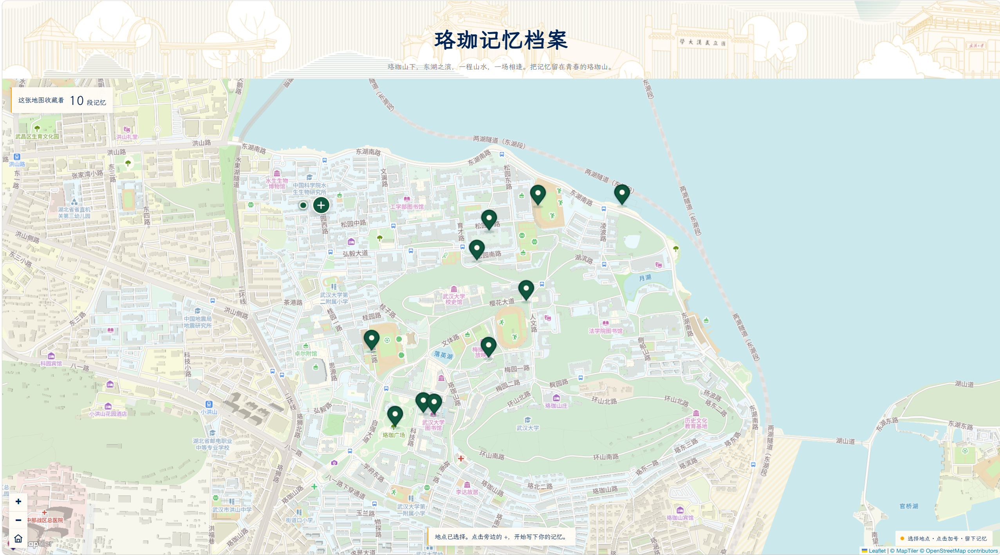
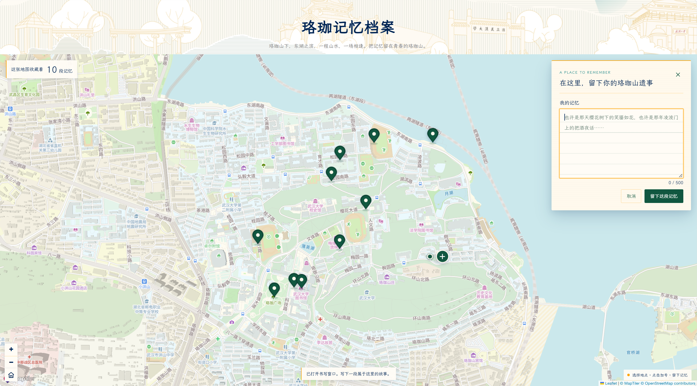

# Luojia Memory Map | 珞珈记忆档案

*Every place holds a story.*

Luojia Memory Map is an interactive website where visitors can leave and discover personal memories connected to places around Wuhan University.

## About the Project

A conventional map shows roads, buildings, and geographical locations. However, the same place may hold very different meanings for different people.

A classroom, a pathway, or a lakeside can carry memories that are invisible on an ordinary map.

This project aims to create a shared collection of these personal stories.

It is designed for Wuhan University students, alumni, and anyone who has memories associated with the campus.

Visitors can contribute anonymously without creating an account.

## Live Website

**[Explore Luojia Memory Map](https://zhangyan-sybil.github.io/Luojia-Memory-Map/)**

The website is hosted on GitHub Pages and can be accessed through a modern web browser.

## How to Interact

1. Explore the interactive map of Wuhan University.
2. Click a location that holds a personal memory.
3. Click the **+** button beside the selected location.
4. Write a short memory in the writing panel.
5. Click **留下这段记忆** to save it.
6. A marker appears on the map, allowing visitors to read the memory.

Visitors can also click existing markers to discover stories left by others.

The interaction follows a simple cycle:

**Input → Response → Feedback**

- **Input:** Selecting a location and writing a memory.
- **Response:** Saving the memory and creating a geographical marker.
- **Feedback:** Displaying the saved memory, updating the memory count, and showing the result of the action.

The Home button returns the map to its original campus view.

## Screenshot




*The interactive map and its collection of personal memories.*

## Technologies

- **HTML, CSS, JavaScript:** Website structure, design, and interaction.
- **Leaflet:** Interactive map controls and memory markers.
- **MapTiler:** Customized geographical map style.
- **Supabase:** Cloud storage for shared memories.
- **GitHub Pages:** Public website hosting.

## How to Run Locally

### Requirements

- A modern web browser
- An internet connection
- Visual Studio Code with the Live Server extension, or another local HTTP server
- Valid MapTiler and Supabase configuration

### Steps

**1. Clone the repository**

```bash
git clone https://github.com/ZHANGYan-Sybil/Luojia-Memory-Map.git
```

**2. Open the project folder**

```bash
cd Luojia-Memory-Map
```

**3. Check the configuration**

The project uses `config.js` for browser-side service configuration.

Ensure that the MapTiler API key and Supabase public configuration are valid.

Do not include secret or service-role keys in client-side code.

**4. Start the website**

Open `index.html` in Visual Studio Code and select **Open with Live Server**.

The browser will open the local website.

The map and shared memories require an internet connection.

## Known Limitations

- The current version supports text memories only; image uploads are not available.


## Credits

**Project concept, design, and development:** ZHANGYan-Sybil

**Libraries and services:**

- [Leaflet](https://leafletjs.com/) — Interactive mapping library.
- [MapTiler](https://www.maptiler.com/) — Map hosting and customized map style.
- [OpenStreetMap contributors](https://www.openstreetmap.org/copyright) — Geographical data.
- [Supabase](https://supabase.com/) — Cloud database.
- [LXGW WenKai](https://github.com/lxgw/LxgwWenKai) — Chinese typography.


---

*Luojia Memory Map — 珞珈山下，每个地方都有自己的故事。*